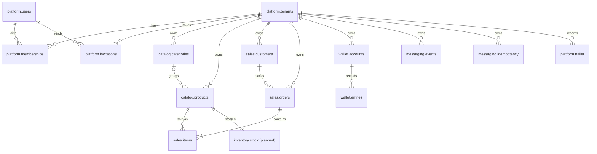
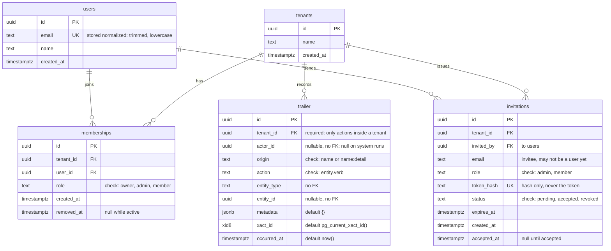
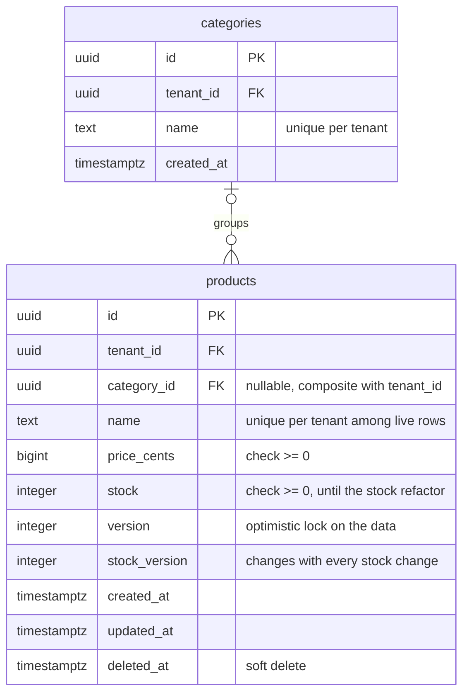
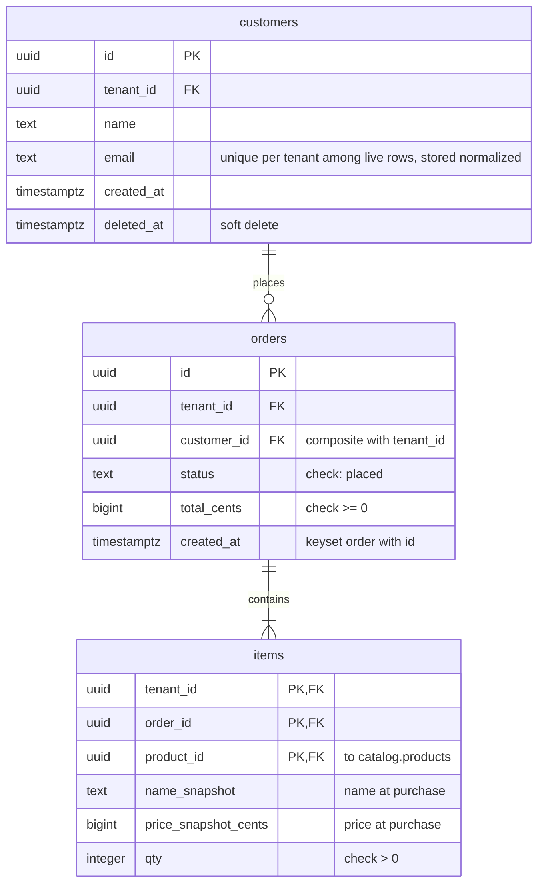
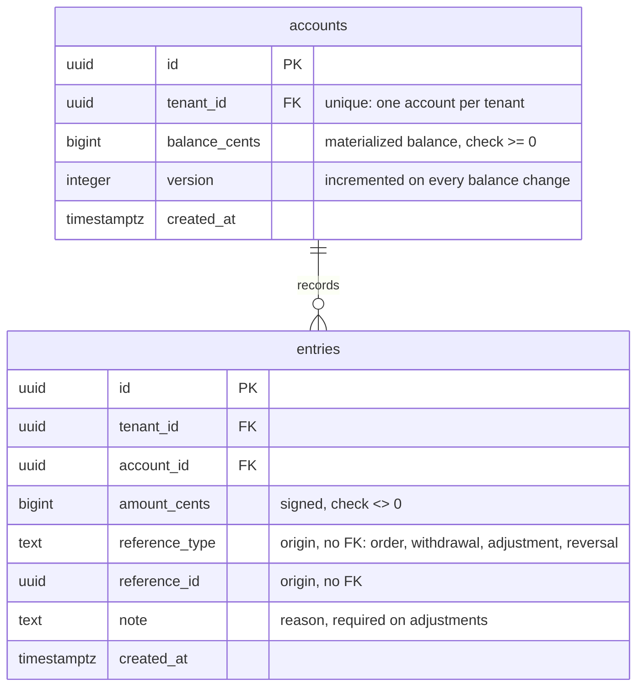
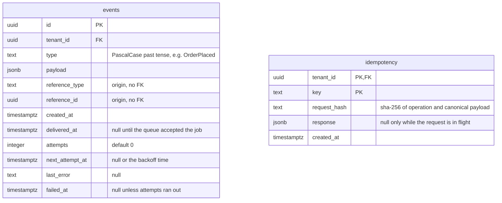
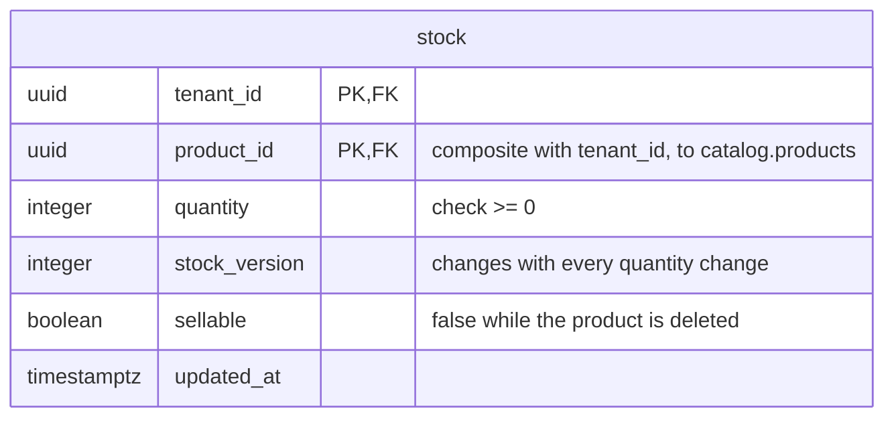

# Data model

Entity-relationship model of the PostgreSQL database, one Mermaid diagram per schema plus a global map of relations. Column lists are indicative and are finalized by the migration of each slice. The `platform` tables are already migrated; every other schema is target design, as the slices' specs describe it.

## Schemas and tables

| Schema | Tables | Purpose |
|---|---|---|
| `platform` | `tenants`, `users`, `memberships`, `invitations`, `trailer` | Identity, tenancy, invitations to join a tenant, and the append-only audit trail. Migrated. |
| `catalog` | `categories`, `products` | Sellable items and, until the stock refactor, their stock. |
| `sales` | `customers`, `orders`, `items` | Purchases and their lines. |
| `wallet` | `accounts`, `entries` | Tenant balance and its immutable ledger. |
| `messaging` | `events`, `idempotency` | Outbox and idempotent request outcomes. |
| `inventory` (planned) | `stock` | Introduced by the stock refactor; takes stock over from `catalog.products`. |
| `reporting` | views only | Read-only projections for the query side, defined with the read queries. |

## Conventions

### Identifiers

- Every `id` is a UUID v7 generated by the application before the insert. There is no database default, so the id is known inside the use case (for the outbox, audit and idempotency records written in the same transaction) and ordering follows creation time.
- Tenant-scoped tables use a single-column `id` primary key. `tenant_id` is a separate indexed column, not part of the key.
- Composite primary keys appear only where the key is naturally a tuple: `sales.items (tenant_id, order_id, product_id)`, `messaging.idempotency (tenant_id, key)` and, once it exists, `inventory.stock (tenant_id, product_id)`.
- A table that another tenant-scoped table references carries a `unique (tenant_id, id)`, which is the target of composite foreign keys (see Constraints).

### Tenancy

- Every tenant-scoped table carries `tenant_id`, a foreign key to `platform.tenants`, and a row-level policy comparing it to the transaction's tenant setting.
- `platform.tenants` is the root and has no policy. `platform.users` is global: a user can belong to several tenants through `platform.memberships`.
- Reporting objects cannot rely on policies (a view runs with its owner's rights and a materialized view has none), so each exposed view carries its own tenant predicate.

### Types

| Concept | Type | Reason |
|---|---|---|
| Money | `bigint` in minor units (cents), one fixed currency | Exact integer arithmetic; no decimal-as-string handling in TypeScript. |
| Stock and quantities | `integer` with a check constraint | The database refuses negative stock whatever the concurrency strategy. |
| Timestamps | `timestamptz` | Unambiguous instants. |
| Free-form structured data | `jsonb` | Outbox payloads, idempotent responses, audit metadata. |
| Enumerations | `text` with a check constraint | Cheaper to evolve than a Postgres enum type. |

### Column suffixes and names

| Name | Meaning |
|---|---|
| `*_cents` | Money in minor units. |
| `*_snapshot` | Value copied at write time, independent of later changes to the source row. |
| `created_at` | Set once by the application at insert. |
| `updated_at` | Set by the application on every update, on mutable tables only. |
| `deleted_at` | Soft delete marker on products and customers; `NULL` means live. |
| `removed_at` | Soft delete marker on memberships; `NULL` means active. |
| `version` | Integer incremented on every edit of a product's data, used for optimistic locking. |
| `stock_version` | Integer incremented on every stock change, kept apart from `version` so sales never invalidate a data edit. |
| `reference_type`, `reference_id` | Origin of a record, held by type and id with no foreign key. |

### Constraints

- Soft-deletable tables (`catalog.products`, `sales.customers`, `platform.memberships`) enforce uniqueness only on live rows through a partial unique index (`WHERE deleted_at IS NULL`, or `WHERE removed_at IS NULL` for memberships), so a deleted value can be reused.
- Tables that must not change once written have no `updated_at` or `deleted_at` and the application role can only insert and select: `wallet.entries` through its schema's default grants, `platform.trailer`, `sales.orders` and `sales.items` through row-level policies that allow only select and insert. `messaging.events` is append-only except for its delivery columns, and a committed `messaging.idempotency` row can no longer be updated.
- Foreign keys cross schemas only toward `platform.tenants`, from `sales.items` to `catalog.products` and, once it exists, from `inventory.stock` to `catalog.products`. Wallet, messaging and the audit trail stay decoupled and refer to their origin by type and id.
- Foreign keys between tenant-scoped tables are composite, `(tenant_id, x)` to the target's `(tenant_id, id)`, so a row can never reference a row of another tenant: products to categories, orders to customers, items to orders and to products, and stock to products.
- Order of list reads is `(created_at, id)`, so list tables index on `(tenant_id, created_at, id)`.

## Relations map

Keys and relations only; attributes are in the per-schema diagrams.

`wallet.entries`, `messaging.events` and `platform.trailer` also point at their origin (an order, a withdrawal, any entity) through `reference_type` and `reference_id` or `entity_type` and `entity_id`; those links have no foreign key and are not drawn.

## platform

`tenants` has no row-level policy. `users` is not tenant-scoped.

`memberships` has its own `id` and a soft delete: a partial unique index on `(tenant_id, user_id) WHERE removed_at IS NULL` allows one active membership per user and tenant, and a user who returns after being removed gets a new row.

`invitations` is tenant-scoped. The invitee is identified by email because the person may not have a user yet; accepting creates the membership (and the user if needed), so there is no foreign key to the invitee. Expiry is derived from `expires_at`, not stored as a status. A partial unique index on `(tenant_id, email) WHERE status = 'pending'` allows one open invitation per email and tenant, and the owner role can only be assigned through membership, never by invitation. Looking an invitation up by token happens before the tenant is known, so that read needs a dedicated path when row-level security lands.

`trailer` is the audit trail: one row per audited action, written in the same transaction as the change. `tenant_id` is required: the trail traces what happens inside tenants, so actions outside any tenant (signing up a user, creating a tenant) are not audited, and the insert policy requires the row's tenant to equal the transaction's. `actor_id` is null on system runs, and `origin` always says which process wrote the row. `xact_id` groups the entries of one transaction. Row-level security allows the application role only select (rows of the current tenant) and insert (tenant, actor and origin must match the transaction settings), so rows are never updated or deleted. It is a candidate for monthly partitioning by `occurred_at`; if partitioned, the primary key becomes `(id, occurred_at)` because Postgres requires the partition key in every unique constraint.

## catalog

`categories` carries `unique (tenant_id, id)`, the target of the composite foreign key from `products`, declared `ON DELETE SET NULL (category_id)` so that deleting a category nulls only the category and never the tenant. `products` carries `unique (tenant_id, id)` for the foreign keys that point at it. Categories are the only hard-deleted table of the catalog.

Until the stock refactor, `catalog` owns stock. Stock changes go through the concurrency strategy under evaluation, and the check constraint is the last line of defense. Data edits check `version`; stock changes bump `stock_version`.

## sales

`customers` and `orders` carry `unique (tenant_id, id)`, the targets of the composite foreign keys from `orders` and `items`. `items` references `catalog.products` across schemas; the snapshots make an item independent of later product edits or deletion. Orders and items are immutable: their policies allow select and insert only. An order's total equals the sum of its items' `price_snapshot_cents * qty`.

## wallet

`balance_cents` is updated in the same transaction that inserts the entry, with a conditional update that refuses to go below zero, so it always equals the sum of the account's entries. `entries` is an immutable ledger: insert and select only, and `unique (tenant_id, reference_type, reference_id)` lets an origin produce at most one entry. The application role updates only `balance_cents` and `version` on `accounts`, through a column-level grant.

## messaging

`events` is the outbox: an event is committed if and only if the change that produced it committed. A partial index on undelivered, non-failed rows serves the polling query. The application role only inserts events; the relayer reads them and updates the delivery columns (`delivered_at`, `attempts`, `next_attempt_at`, `last_error`, `failed_at`) through a column-level grant. `idempotency` allows one stored outcome per tenant and key; its row is created without a response at the start of the unit of work and completed at the end, and a committed row can no longer be updated.

## inventory (planned)

Introduced by the stock refactor. One row per product, created with the product and never deleted. `sellable` mirrors "the product is not deleted" and changes in the same transaction as the product's delete or restore, so a reservation never has to read the product. After the refactor `catalog.products` loses `stock` and `stock_version`.

## reporting

No physical tables. Read-only views and materialized views over the other schemas, defined together with the read queries and granted to the `reader` role only.

- Every exposed object is a regular view with the security-barrier option and a mandatory tenant predicate in its definition; materialized views are internal storage and are never granted.
- Report objects: sales per product and month (a materialized view of the aggregate plus the view that exposes it with its `as_of`), top customers by revenue (live) and low stock with sales rotation (live).
- The `reader` role has `USAGE` on this schema and `SELECT` on its views, and nothing else.
