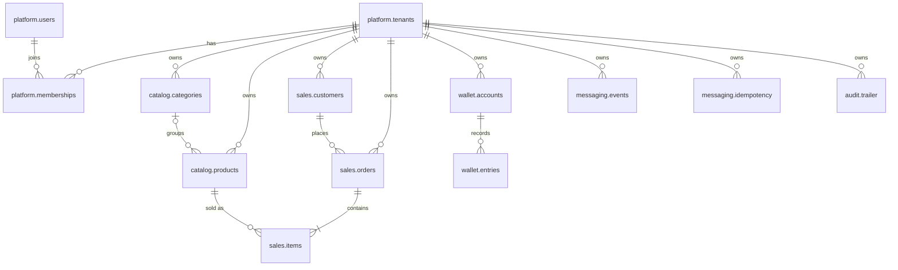
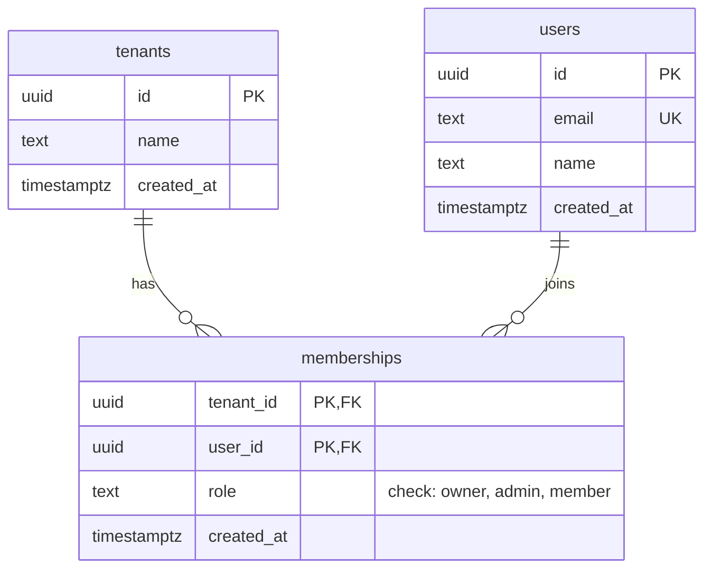
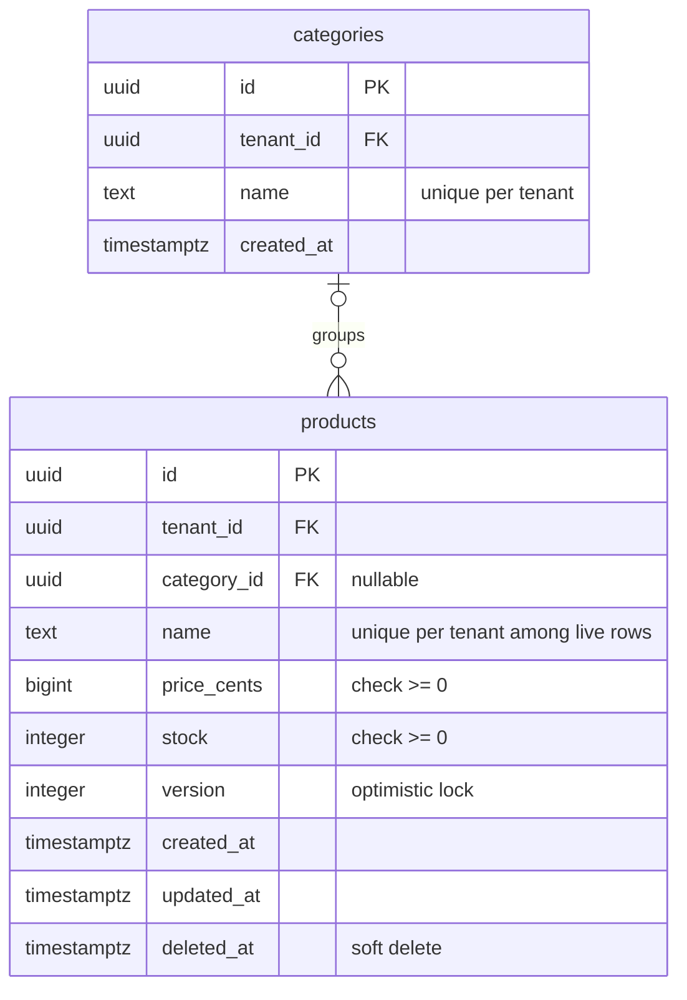
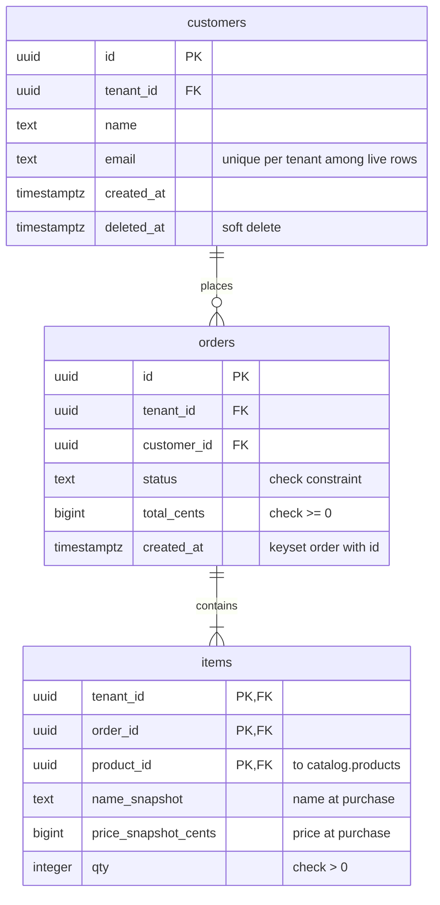
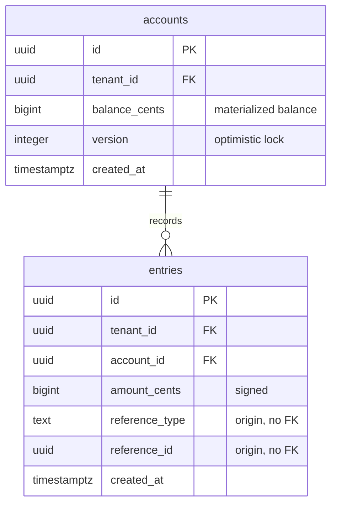
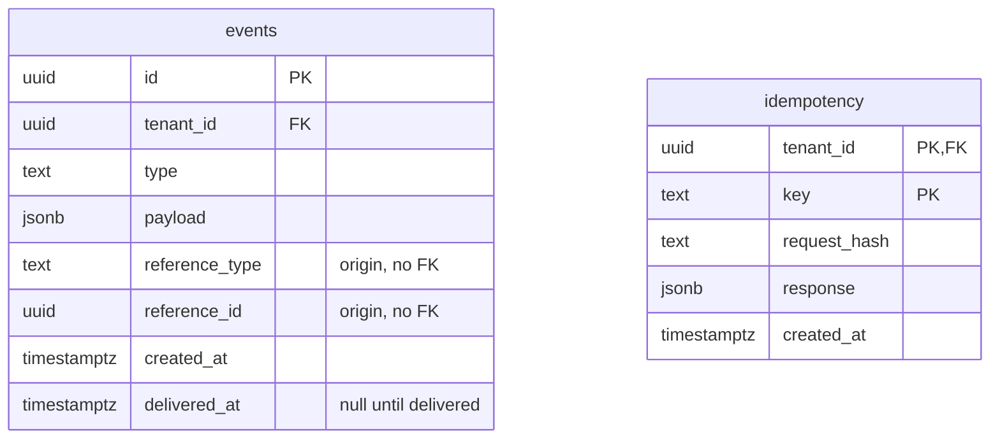
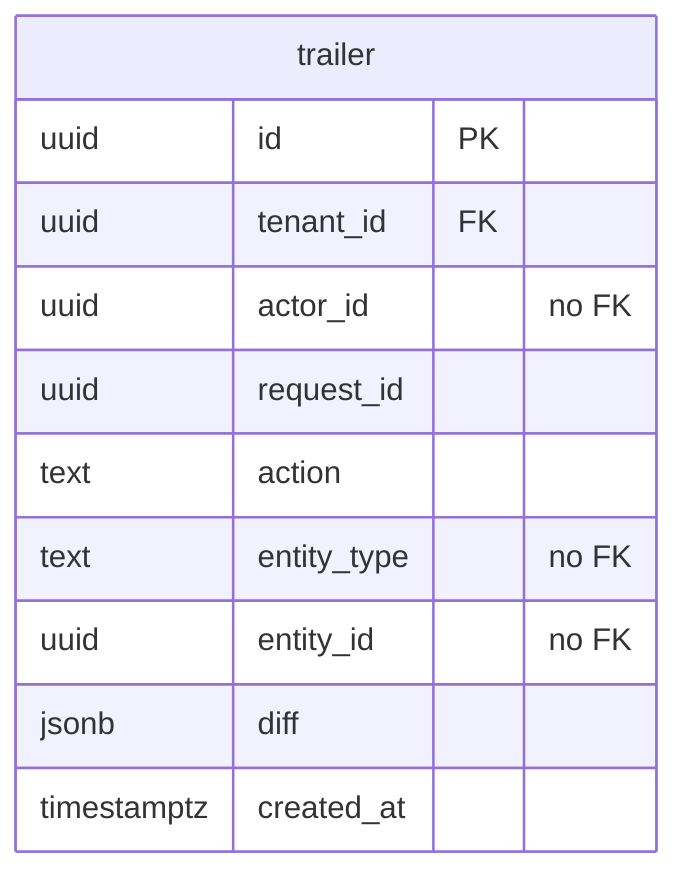

# Data model

Entity-relationship model of the PostgreSQL database, one Mermaid diagram per schema plus a global map of relations. Column lists are indicative and are finalized with the first migration.

## Schemas and tables

| Schema | Tables | Purpose |
|---|---|---|
| `platform` | `tenants`, `users`, `memberships` | Identity and tenancy. |
| `catalog` | `categories`, `products` | Sellable items and their stock. |
| `sales` | `customers`, `orders`, `items` | Purchases and their lines. |
| `wallet` | `accounts`, `entries` | Tenant balance and its immutable ledger. |
| `messaging` | `events`, `idempotency` | Outbox and idempotent request outcomes. |
| `audit` | `trailer` | Append-only record of audited actions. |
| `reporting` | views only | Read-only projections for the query side, defined with the read queries. |

## Conventions

### Identifiers

- Every `id` is a UUID v7 generated by the application before the insert. There is no database default, so the id is known inside the use case (for the outbox, audit and idempotency records written in the same transaction) and ordering follows creation time.
- Tenant-scoped tables use a single-column `id` primary key. `tenant_id` is a separate indexed column, not part of the key.
- Composite primary keys appear only where the key is naturally the pair: `platform.memberships (tenant_id, user_id)`, `sales.items (tenant_id, order_id, product_id)`, `messaging.idempotency (tenant_id, key)`.

### Tenancy

- Every tenant-scoped table carries `tenant_id`, a foreign key to `platform.tenants`, and a row-level policy comparing it to the transaction's tenant setting.
- `platform.tenants` is the root and has no policy. `platform.users` is global: a user can belong to several tenants through `platform.memberships`.

### Types

| Concept | Type | Reason |
|---|---|---|
| Money | `bigint` in minor units (cents), one fixed currency | Exact integer arithmetic; no decimal-as-string handling in TypeScript. |
| Stock and quantities | `integer` with a check constraint | The database refuses negative stock whatever the concurrency strategy. |
| Timestamps | `timestamptz` | Unambiguous instants. |
| Free-form structured data | `jsonb` | Outbox payloads, idempotent responses, audit diffs. |
| Enumerations | `text` with a check constraint | Cheaper to evolve than a Postgres enum type. |

### Column suffixes and names

| Name | Meaning |
|---|---|
| `*_cents` | Money in minor units. |
| `*_snapshot` | Value copied at write time, independent of later changes to the source row. |
| `created_at` | Set once by the application at insert. |
| `updated_at` | Set by the application on every update, on mutable tables only. |
| `deleted_at` | Soft delete marker; `NULL` means live. |
| `version` | Integer incremented on every update, used for optimistic locking. |
| `reference_type`, `reference_id` | Origin of a record, held by type and id with no foreign key. |

### Constraints

- Soft-deletable tables (`catalog.products`, `sales.customers`) enforce uniqueness only on live rows through a partial unique index `WHERE deleted_at IS NULL`, so a deleted value can be reused.
- Immutable tables (`wallet.entries`, `audit.trailer`) have no `updated_at` or `deleted_at`; the application role can only insert and select (or insert only, for audit).
- Foreign keys cross schemas only toward `platform.tenants` and from `sales.items` to `catalog.products`. Wallet, messaging and audit stay decoupled and refer to their origin by type and id.
- Order of list reads is `(created_at, id)`, so list tables index on `(tenant_id, created_at, id)`.

## Relations map

Keys and relations only; attributes are in the per-schema diagrams.

`wallet.entries`, `messaging.events` and `audit.trailer` also point at their origin (an order, a payment, any entity) through `reference_type` and `reference_id` or `entity_type` and `entity_id`; those links have no foreign key and are not drawn.

## platform

`tenants` has no row-level policy. `users` is not tenant-scoped.

## catalog

`catalog` owns stock. Stock changes go through the concurrency strategy under evaluation, and the check constraint is the last line of defense.

## sales

`items` is the only table that references another schema besides `platform.tenants`: `product_id` points to `catalog.products`. The snapshots make an item independent of later product edits or deletion.

## wallet

`balance_cents` is updated in the same transaction that inserts the entry, so it always equals the sum of the account's entries. `entries` is an immutable ledger: insert and select only.

## messaging

`events` is the outbox: an event is committed if and only if the change that produced it committed. A partial index on undelivered rows serves the polling query. `idempotency` allows one stored outcome per tenant and key.

## audit

Append-only for the application role. It is a candidate for monthly partitioning by `created_at`; if partitioned, the primary key becomes `(id, created_at)` because Postgres requires the partition key in every unique constraint.

## reporting

No physical tables. Read-only views and materialized views over the other schemas, defined together with the read queries and granted to the reader role only.
