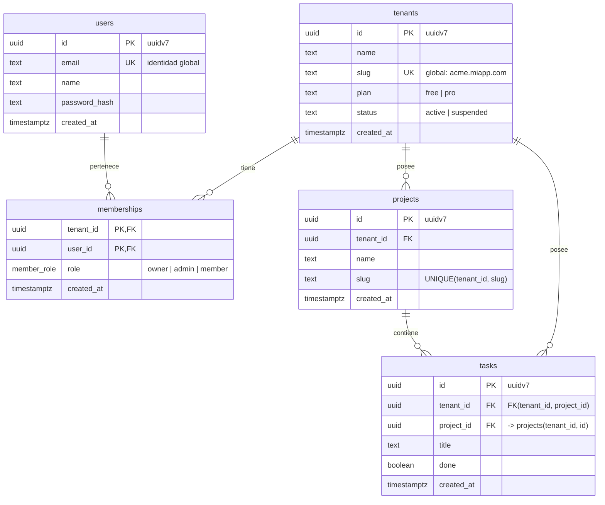

# Diagrama de persistencia (multi-tenant)

Estrategia: **base de datos compartida + columna `tenant_id`**, con aislamiento reforzado por
**Row-Level Security (RLS)** en PostgreSQL.



## Clasificación de tablas

| Tabla         | Alcance        | `tenant_id` | RLS | Motivo                                                        |
| ------------- | -------------- | ----------- | --- | ------------------------------------------------------------- |
| `tenants`     | global         | —           | ✅  | Cada tenant sólo puede leerse a sí mismo (`id = tenant actual`) |
| `users`       | global         | —           | ❌  | Una persona puede estar en varios tenants                     |
| `memberships` | puente N:M     | ✅          | ✅  | Rol del usuario **dentro** de cada tenant                     |
| `projects`    | tenant         | ✅          | ✅  | Dato de negocio                                               |
| `tasks`       | tenant         | ✅          | ✅  | Dato de negocio                                               |

## Restricciones clave

| Tabla         | Restricción                                                            | Para qué                                                   |
| ------------- | ---------------------------------------------------------------------- | ---------------------------------------------------------- |
| `tenants`     | `UNIQUE(slug)`                                                         | Subdominio / URL único                                     |
| `users`       | `UNIQUE(email)`                                                        | Identidad global                                           |
| `memberships` | `PRIMARY KEY(tenant_id, user_id)`                                      | Un usuario, un rol por tenant                              |
| `projects`    | `UNIQUE(tenant_id, slug)`                                              | Unicidad **por tenant**, no global                         |
| `projects`    | `UNIQUE(tenant_id, id)`                                                | Destino de la FK compuesta de `tasks`                      |
| `tasks`       | `FOREIGN KEY(tenant_id, project_id) REFERENCES projects(tenant_id, id)` | Impide que una task apunte a un proyecto de otro tenant    |
| todas         | `ON DELETE CASCADE` desde `tenants`                                    | Borrar un tenant elimina todos sus datos                   |

Índices: todos empiezan por `tenant_id` (ej. `INDEX(tenant_id, created_at)`), porque toda consulta
filtra primero por tenant.

## Flujo de aislamiento con RLS

```text
request ──► auth: user_id + tenant_id ──► ¿existe membership(user_id, tenant_id)?
                                                    │ sí
                                                    ▼
                               BEGIN;
                               SET LOCAL ROLE app_user;                          -- rol SIN superuser / BYPASSRLS
                               SELECT set_config('app.tenant_id', $1, true);     -- true = sólo esta transacción
                               ... queries normales (sin WHERE tenant_id) ...
                               COMMIT;
                                                    │
                                                    ▼
                  policy: USING (tenant_id = current_setting('app.tenant_id')::uuid)
```

Política tipo, aplicada a cada tabla con `tenant_id`:

```sql
ALTER TABLE projects ENABLE ROW LEVEL SECURITY;
ALTER TABLE projects FORCE  ROW LEVEL SECURITY;  -- también aplica al dueño de la tabla

CREATE POLICY tenant_isolation ON projects
  USING      (tenant_id = current_setting('app.tenant_id', true)::uuid)
  WITH CHECK (tenant_id = current_setting('app.tenant_id', true)::uuid);
```

> ⚠️ Los **superusers** y los roles con `BYPASSRLS` **ignoran siempre RLS**, incluso con `FORCE`.
> Por eso las queries de la app deben ejecutarse como `app_user`, nunca como el superuser del contenedor.
